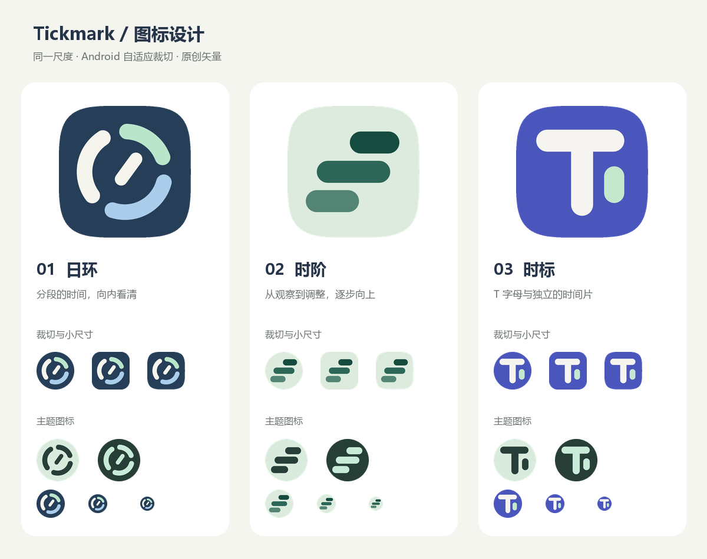

# Tickmark 图标候选

用户选中日环后新增 [六套日环精修方案](orbit-refinements/README.md)，包含三类圆弧结构与六组配色；下方保留首轮三方向比较。

2026-11-08。三套原创代码矢量方案，已完成视觉修订与 Android 原生资源验证，尚未替换应用当前图标。

设计从“观察手机使用、理解时间分布”出发，把自我调整与逐步改善作为可选的视觉含义，而非必须表达的口号。

| 方案 | 设计与取舍 |
| --- | --- |
| 01 日环（首选） | 三段圆弧表示一天中不同的使用时段，中央斜刻度提供方向感。深蓝、雾蓝、薄荷绿与暖白，稳定而清楚。与时间分析联系最直接；仍可能让人联想到时钟类应用。 |
| 02 时阶 | 三枚错位的时间片形成向上的阶梯，把时间记录和逐步改善联系起来。鼠尾草绿背景更平静。避免普通增长柱图与信号强度图标的外形，但与“时间”的联系较抽象。 |
| 03 时标 | Tickmark 的 T 与一枚独立时间片组合，紫蓝底色突出字母轮廓。适合以名称建立品牌识别；需要通过应用名称补充用途。 |

## 文件

每个编号目录包含：

- `color.svg`：108×108 坐标的完整彩色自适应图层合成，背景全幅、不预裁圆角。
- `foreground.svg` / `foreground.png`：透明前景，可编辑矢量及 1024 像素导出。
- `theme-light.svg` / `theme-dark.svg`：示例主题色效果。实际 Android 主题颜色由系统决定。
- `store-1024.png`：1024×1024、不透明、无预制圆角的方形展示源图；不是已经过 App Store 或 Google Play 验收的发布资产。
- `preview-circle.png` / `preview-rounded.png` / `preview-squircle.png`：按自适应图标中央 72dp 可视窗口生成的裁切预览。
- `preview-24.png` / `preview-32.png` / `preview-48.png` / `preview-64.png`：小尺寸圆形预览。
- `android-res/`：原生 VectorDrawable 背景、前景、单色层，以及 API 26 / API 33 的 adaptive-icon 定义。

三套 Android 资源使用相同资源名，供选定其中一套后接入，不能把三套目录同时合并。接入时复制所选目录的 `android-res/` 内容至 `app/src/main/res/`，将 Manifest 的 `android:icon` 指向 `@mipmap/ic_concept`；正式落地时可统一重命名为 `ic_launcher`。最低 API 29，无需额外旧版位图回退。

## 规范与验证

参考 [Android 自适应图标规范](https://developer.android.com/develop/ui/compose/system/icon_design_adaptive) 与 [Apple App icons 指南](https://developer.apple.com/design/human-interface-guidelines/app-icons)：主体简洁、背景克制、边缘清晰、不在源图中预制外轮廓圆角，不把整张界面缩成图标。

- Android 图层采用 108dp 画布，主体均在中心直径 66dp 的安全圆内；对透明前景按像素测量验证，最大半径分别为 26.26、31.60、31.47dp，小于 33dp。
- 提供独立单色层；单色时仍保留时间片和圆弧间隙，不依赖配色识别。
- 实际视觉检查圆形、圆角方形与连续曲线近似裁切，以及 24 / 32 / 48 / 64 像素预览。
- 原生资源通过 aapt2 编译与链接；独立验证 APK 安装至 Keye_Phone_API_36，使用真正的 VectorDrawable / AdaptiveIconDrawable，检查 24 / 48 / 64dp、浅深背景和单色效果，并检查桌面启动器中的显示。验证包已卸载。
- 首轮发现日环端点粘连，已增加角度间隔并复查；时阶由普通柱形改为错位时间片；淘汰容易被误认为退出图标的开放框方案；时标修正了容易读成 J 的弯钩。
- 本次没有更改应用代码或版本，没有执行与图标候选无关的业务测试。未进行真机、其他厂商启动器或 iOS Icon Composer 验证；Apple 分层材质版本仍需目标平台专门制作。

生成采用纯代码矢量与程序化栅格导出，未使用 AI 位图生成。SVG 与 Android XML 是可继续维护的设计源文件。临时脚本、原生验证 APK 与截图统一位于忽略提交的 `build/diagnostics/icon-design/`。
