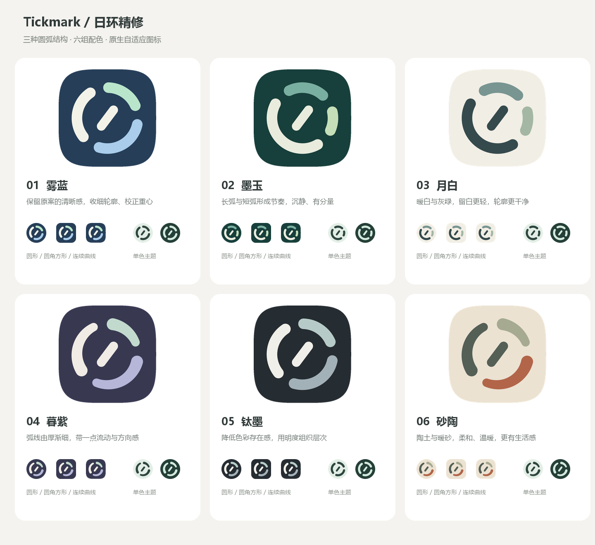

# 日环精修

沿用用户选中的第一版日环，提供六组配色、三类结构。所有候选均为原创矢量，未替换应用当前图标。

## 设计判断

优先推荐 **02 墨玉**：深绿背景、米白长弧和两段灰绿短弧，比原案的三色均衡分布更有主次，适合安静的个人观察工具。**04 暮紫**更强调图形自身的变化：圆弧从 8.8dp 渐收至 6.2dp，增加流动感，同时保留圆头和稳定的外轮廓。**01 雾蓝**最接近原案，适合保留已有偏好。

| 编号 | 名称 | 背景 | 弧线配色 | 结构与取舍 |
| --- | --- | --- | --- | --- |
| 01 | 雾蓝 | `#263E58` | `#A9CDEB` / `#F3F2E9` / `#B9E6CB` | 均衡分段，7.8dp等宽；最接近原案，信息表达清楚 |
| 02 | 墨玉 | `#173F3B` | `#E9EBDD` / `#79AFA0` / `#C5DFB8` | 148°、68°、36°长短弧；主次更鲜明，形态更不对称 |
| 03 | 月白 | `#F1EEE5` | `#354A4D` / `#789591` / `#A3B7A4` | 与墨玉同构，暖白与灰绿；浅色背景上的外边界较轻 |
| 04 | 暮紫 | `#383951` | `#B6B6D9` / `#F0EBE4` / `#C2DACE` | 圆弧粗细渐变；有雕塑感，小尺寸仍保留三段间隙 |
| 05 | 钛墨 | `#252C32` | `#A2B1B7` / `#F0EEE8` / `#B6CBC7` | 与雾蓝同构，接近单色；克制但彩色辨识特征较弱 |
| 06 | 砂陶 | `#EBE2D2` | `#B26549` / `#545F56` / `#A6AA91` | 与暮紫同构，陶土强调色；温暖，偏生活工具气质 |

六套共同调整：圆环中心线半径 22.5dp；中央刻度以 (54,54) 居中，修正初版偏右上的重心；圆弧分段保留明确间隔；彩色前景与背景分离，单色版直接保留几何特征。长弧首轮出现笑脸联想，已整体旋转外环分段，避免下方长弧直接形成嘴形。

## 资源与使用

每套目录提供：

- `color.svg`、`foreground.svg/png`：108dp画布的完整合成和透明前景。
- `theme-light.svg/png`、`theme-dark.svg/png`：示例主题色，实际颜色由启动器决定。
- `store-1024.png`：不透明、无预制圆角的1024像素方形展示源图。
- `preview-circle.png`、`preview-rounded.png`、`preview-squircle.png`：三类预览裁切，连续曲线为近似示意。
- `preview-24/32/48/64.png`：小尺寸圆形预览。
- `android-res/`：前景、背景、单色 VectorDrawable 及 API26/API33 自适应图标定义。

各套资源名相同，选定后只接入一套。接入说明与规范链接见 [上级说明](../README.md)。渐细弧线已转换为闭合填充轮廓，Android无需依赖渐变描边功能。没有预制边框阴影、玻璃高光或图标外部圆角。

## 已执行验证

- 六套Android资源经aapt2编译、链接、打包，安装独立验证APK到Keye_Phone_API_36；实际截图检查彩色64dp/24dp、单色48dp和浅深背景，无弧线粘连、轮廓缺口或主体裁切。验证包已卸载。
- 六套前景的最大半径：26.41、26.41、26.41、26.90、26.41、26.90dp，均在中心半径33dp安全圆内。
- 检查离线24/32/48/64像素预览与三类裁切；XML解析通过。
- 颜色采用实色，通过配色和轮廓表达层次；本轮未进行真机、其他厂商启动器、iOS验证或无关业务测试。没有替换现有图标或发布版本。

纯代码SVG与原生XML为设计源文件；临时生成脚本、资源编译和模拟器截图位于忽略提交的 `build/diagnostics/icon-design/`。本轮六套独立打包于 `tickmark-orbit-refinements.zip`。

## 正式接入

2026-11-08，经用户确认，0.4.0接入01雾蓝。应用使用ic_launcher自适应图标，包含独立单色层；原ic_tickmark资源已移除。以上候选阶段的验证描述保留原始范围。
